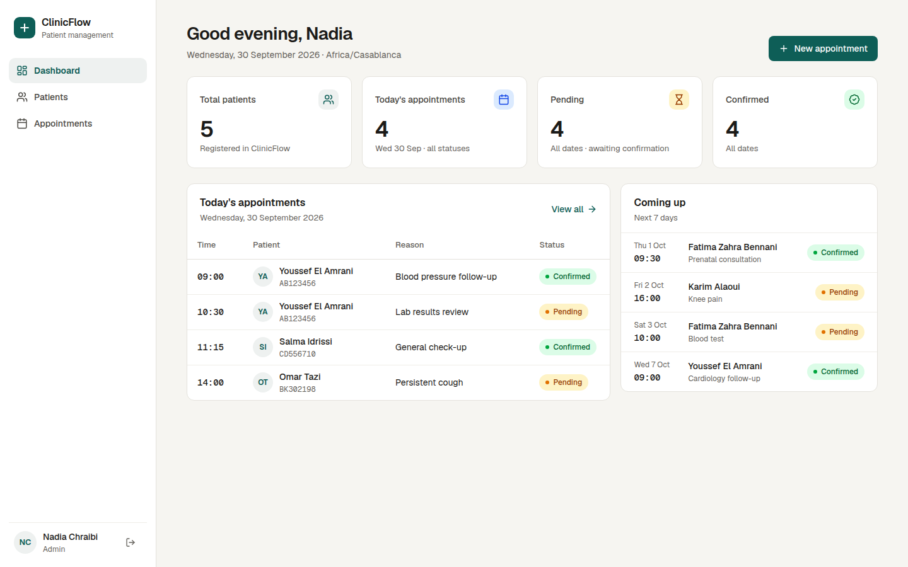
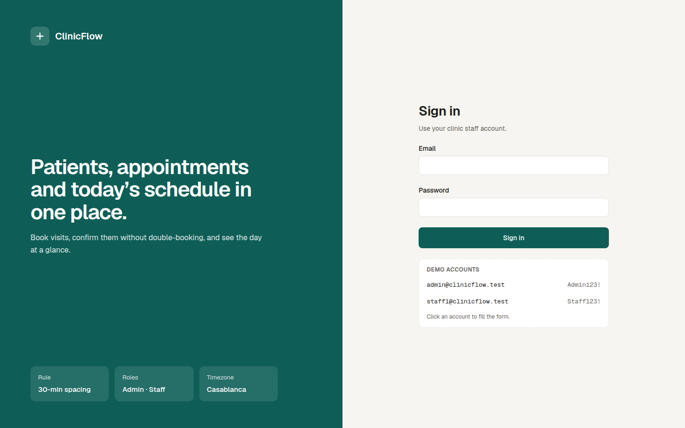
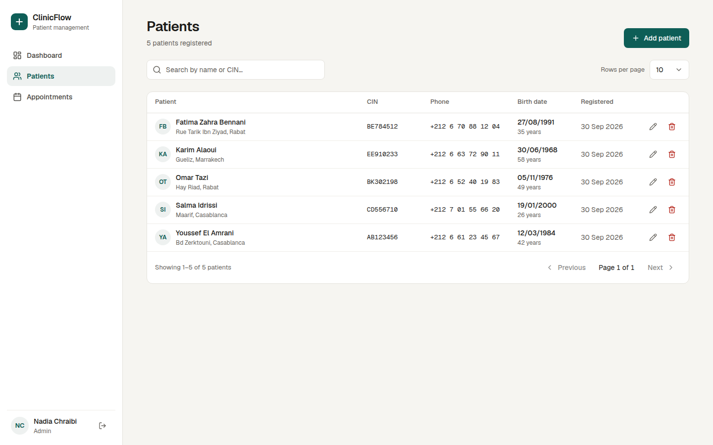
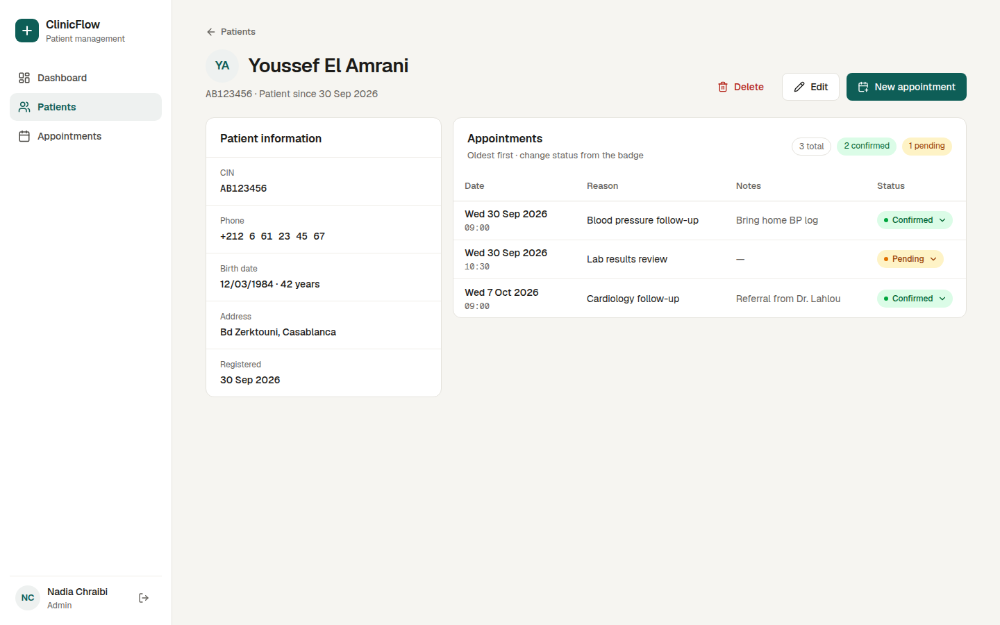
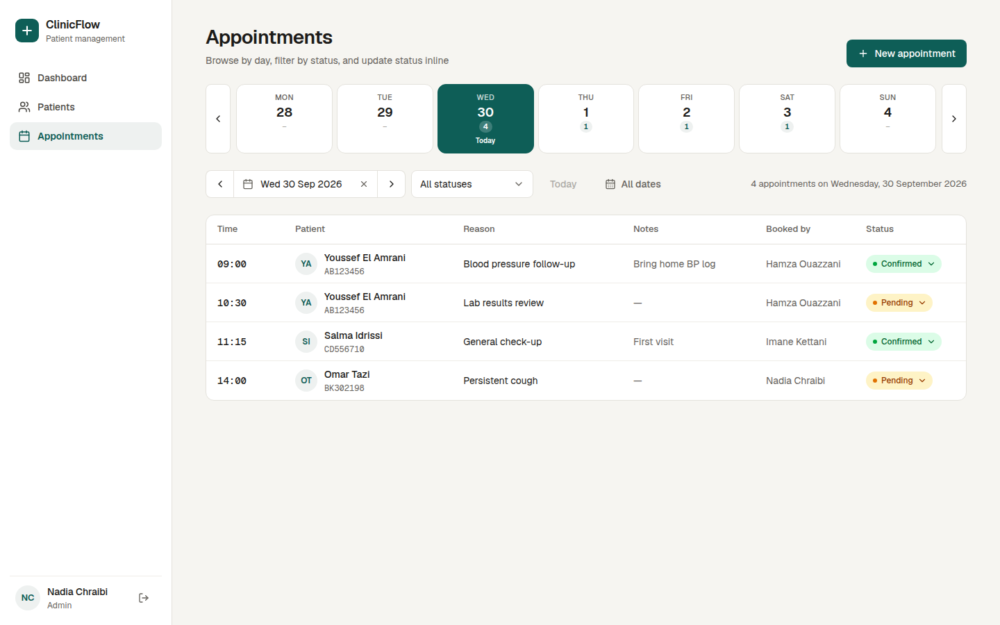

# ClinicFlow

A small PERN app (PostgreSQL, Express, React, Node) for a clinic: patients, appointments, users with roles, and a
dashboard. It enforces the rule that a patient can't have two confirmed appointments less than 30 minutes apart.



More screens are in [Screenshots](#screenshots).

## Getting started

Works the same on **Windows, macOS and Linux**.

### 1. Install the requirements

| Tool | Version | Why | Check |
|---|---|---|---|
| [Docker Desktop](https://www.docker.com/products/docker-desktop/) (Windows, macOS) or Docker Engine + Compose plugin (Linux) | Compose v2 | Runs PostgreSQL, the API and the web app | `docker compose version` |
| [Node.js](https://nodejs.org/) | 20 or newer | Runs the npm scripts in the project root | `node -v` |
| Git | any | To clone the project | `git --version` |

On Windows and macOS, **open Docker Desktop and wait until it says it is running** before going further.

### 2. Get the code and run it

Copy and run these commands in a terminal (PowerShell, Terminal or any shell), one after the other:

```bash
# 1. Download the code
git clone https://github.com/AZOMARDEV/ClinicFlow.git clinicflow
cd clinicflow

# 2. Setup: create the .env file and install the backend + frontend dependencies
npm run setup

# 3. Build the Docker images (database, API, web app)
npm run build

# 4. Run: start the database, the API and the web app
#    (waits until everything is ready, then prints the URLs and demo accounts)
npm start

# 5. Database: create the tables and insert the demo data (seeder)
npm run db:migrate
npm run db:seed

# 6. Optional: run the backend tests
npm test
```

| Step | Command | What it does |
|---|---|---|
| Setup | `npm run setup` | Creates `.env` from `.env.example` (kept if it already exists) and runs `npm ci` in `backend/` and `frontend/` |
| Build | `npm run build` | Builds the `api` and `web` Docker images |
| Run | `npm start` | Starts PostgreSQL, the API and the web app in the background, waits until they answer, prints the URLs and demo accounts |
| Migrate | `npm run db:migrate` | Creates the tables, enums and indexes from `backend/migrations/` (skips what is already applied) |
| Seed | `npm run db:seed` | Inserts the demo data: 1 admin, 2 staff, 5 patients, 10 appointments (skipped if data already exists) |
| Test | `npm test` | Runs the backend tests inside the API container |

Good to know:

- **The short way:** `npm start` alone is enough. It builds the images if needed, and the API runs the
  migrations and the seeder every time it starts. Steps 2, 3 and 5 are there so each part can be run
  and checked on its own, and running them again is safe.
- **First run** takes a few minutes: Docker downloads the base images and installs dependencies inside the containers.
- **Settings:** Compose has defaults for every variable, so the `.env` file is optional for Docker. Edit it to
  change ports, the JWT secret or the time zone (see [Environment variables](#environment-variables)).

### 3. Or: run the API and web app on your machine (hot reload)

For development, only PostgreSQL runs in Docker and the code reloads when you save a file:

```bash
git clone https://github.com/AZOMARDEV/ClinicFlow.git clinicflow
cd clinicflow
npm run setup        # .env + dependencies
npm run dev:local    # starts PostgreSQL, runs migrations + seeder, then the API and web app (Ctrl+C stops both)
```

### 4. Open the app

Go to **http://localhost:5173** and sign in with `admin@clinicflow.test` / `Admin123!`
(or click an account in the "Demo accounts" box on the login page).

| Service | URL |
|---|---|
| Web (Vite + React) | http://localhost:5173 |
| API | http://localhost:4000/api |
| PostgreSQL | localhost:5432 (`clinic` / `clinic`, db `clinicflow`) |

### 5. Stop, restart, start over

```bash
npm stop               # stop the containers (data is kept)
npm start              # start again
npm run db:reset       # while running: wipe the data and run migrations + seeder again
npm run start:fresh    # rebuild everything from an empty database
```

All available commands are listed in [Commands](#commands). The npm scripts wrap Docker Compose;
`docker compose up --build` still works on its own if you prefer.

## Demo accounts

| Role | Email | Password |
|---|---|---|
| Admin | `admin@clinicflow.test` | `Admin123!` |
| Staff | `staff1@clinicflow.test` | `Staff123!` |
| Staff | `staff2@clinicflow.test` | `Staff123!` |

The login page has a "Demo accounts" box: click one to fill the form. Only admins can delete patients.

Seed data: 5 patients, 10 appointments (4 pending, 4 confirmed, 2 cancelled). Dates are relative to the day the
seed runs, so the dashboard always has 4 appointments "today". Youssef El Amrani has 3 appointments.

**Try the 30-minute rule:** open Youssef El Amrani → *New appointment* → pick the day of his confirmed
"Cardiology follow-up" at 09:15 with status *Confirmed* → 409 conflict. 09:30 works.

## Environment variables

| Variable | Default | Used by |
|---|---|---|
| `POSTGRES_USER` / `POSTGRES_PASSWORD` / `POSTGRES_DB` | `clinic` / `clinic` / `clinicflow` | db, api |
| `DATABASE_URL` | built from the above in Compose | api (set it yourself when running outside Docker) |
| `JWT_SECRET` | demo value | api — **min 32 chars, checked at startup** |
| `JWT_EXPIRES_IN` | `8h` | api |
| `APP_TIMEZONE` | `Africa/Casablanca` | api ("today", day filters, seed) and web (display/input) |
| `CORS_ORIGIN` | `http://localhost:5173` | api (comma-separated list allowed) |
| `PORT` | `4000` | api |
| `VITE_API_URL` | `http://localhost:4000/api` | web |
| `DB_PORT` / `API_PORT` / `WEB_PORT` | `5432` / `4000` / `5173` | host ports in Compose |

The API validates its environment with Zod and refuses to start when it is invalid.

## Commands

All commands run from the project root. The scripts live in [`scripts/`](scripts) (plain Node, no dependencies).

### Run with Docker (recommended)

| Command | What it does |
|---|---|
| `npm run build` | Build the Docker images (`npm start` also builds when needed) |
| `npm start` | Build and start db + api + web in the background, wait until ready, print URLs and accounts |
| `npm run start:fresh` | Same, but delete the database volume first (brand-new data) |
| `npm stop` | Stop and remove the containers (data is kept in the volume) |
| `npm run restart` | Restart the running containers |
| `npm run logs` | Follow the logs of all services (`npm run logs:api` for the API only) |
| `npm run ps` | Show container status |
| `npm run clean` | Remove containers **and** the database volume |

### Database (the stack must be running)

| Command | What it does |
|---|---|
| `npm run db:migrate` | Apply pending SQL files from `backend/migrations/` (tracked in `schema_migrations`) |
| `npm run db:seed` | Run the seeder: 3 users, 5 patients, 10 appointments (skipped when `users` is not empty) |
| `npm run db:reset` | Empty the database, then migrate and seed again. Sign in again afterwards |
| `npm run db:psql` | Open a `psql` shell on the database (uses the default `clinic` user and `clinicflow` db) |

### Tests and checks

| Command | What it does |
|---|---|
| `npm test` | Backend tests (Jest + Supertest) inside the API container |
| `npm run typecheck` | TypeScript check of backend and frontend (needs `npm run setup` first) |

Tests use a separate `clinicflow_test` database, created on the first start of the db volume
(`docker/db-init`). Each test file drops and re-migrates that database, so the demo data is never touched.

### Run on your machine (hot reload)

| Command | What it does |
|---|---|
| `npm run setup` | Create `.env` from `.env.example` and install backend + frontend dependencies |
| `npm run dev:local` | Start only PostgreSQL in Docker, migrate + seed, then run the API and web app locally with reload (Ctrl+C stops both) |
| `npm run test:local` | Backend tests from your machine (PostgreSQL must be running) |

`dev:local` stops the `api` and `web` containers first so ports 4000 and 5173 are free. Run `npm start`
to go back to the full Docker stack.

Inside `backend/` and `frontend/` the usual scripts are still there (`npm run dev`, `npm run build`,
`npm run migrate`, `npm run seed`, …).

### Typical flows

```bash
# First time / demo
npm start

# Start over with clean demo data
npm run db:reset          # stack running: fast, no rebuild
npm run start:fresh       # or: rebuild everything from an empty volume

# Develop with hot reload
npm run setup
npm run dev:local
```

## Screenshots

| Login | Dashboard |
|---|---|
|  |  |

| Patients | Patient details |
|---|---|
|  |  |

| Appointments |
|---|
|  |

## Windows, macOS and Linux notes

The npm scripts are plain Node (no Bash), and the app itself runs in Linux containers, so the steps are the
same everywhere. A few details:

- **Windows:** use PowerShell or Windows Terminal. The old `cmd.exe` window may show the ✓ and ▸ symbols as odd
  characters; the commands still work.
- **Windows, Git Bash:** `npm run db:psql` may need `winpty` in front
  (`winpty docker compose exec db psql -U clinic -d clinicflow`). PowerShell does not need it.
- **Windows, line endings:** `.gitattributes` keeps LF endings on checkout, so files used inside the containers
  are not converted to CRLF.
- **Windows and macOS:** Docker Desktop must be running. If it is not, the scripts say so instead of failing
  with a Docker error.
- **Linux:** if `docker` needs `sudo`, add your user to the `docker` group
  (`sudo usermod -aG docker $USER`, then log out and back in) rather than running npm with `sudo`.
- **Apple Silicon and Intel Macs** both work: the images are multi-architecture, and `bcrypt` ships prebuilt
  binaries for `npm run dev:local`.

## Troubleshooting

| Problem | Fix |
|---|---|
| `Docker is not installed or not on PATH` / `Docker is installed but not running` | Install or start Docker Desktop (Windows/macOS) or the Docker service (Linux), then run `npm start` again. |
| `port is already allocated` (5432, 4000 or 5173) | Another program uses the port. Stop it, or pick other ports in `.env` (`DB_PORT`, `API_PORT`, `WEB_PORT`) and set `VITE_API_URL` / `CORS_ORIGIN` to match. |
| `The "api" container is not running` | The `db:*` and `test` scripts need the stack: run `npm start` first. |
| Signed out, or "User no longer exists", after `npm run db:reset` | Expected: users were recreated. Sign in again. |
| `npm test` fails with `database "clinicflow_test" does not exist` | The database volume was created before the test database existed. Run `npm run start:fresh` once. |
| Something looks stuck | `npm run logs` to see what each service is doing, then `npm run start:fresh` to rebuild from scratch. |

## API

Base URL `/api`, JSON only. All routes except login need `Authorization: Bearer <token>`.

| Method | Route | Access | Notes |
|---|---|---|---|
| POST | `/auth/login` | public | `{email, password}` → `{token, user}` (JWT 8h, payload `{sub, role}`) |
| GET | `/auth/me` | auth | current user |
| GET | `/patients?search=&page=1&limit=10` | auth | name or CIN search; `{data, page, limit, total, totalPages}`; `limit` ≤ 50 |
| POST | `/patients` | auth | 409 `CIN_ALREADY_EXISTS` |
| GET | `/patients/:id` | auth | 404 when missing |
| PUT | `/patients/:id` | auth | full update, 409 on CIN clash |
| DELETE | `/patients/:id` | **admin** | 204; deletes the patient's appointments (cascade) |
| GET | `/appointments?date=&from=&to=&status=&patientId=` | auth | days in `APP_TIMEZONE`; ordered by date asc; includes patient name/CIN and booker |
| POST | `/appointments` | auth | `created_by` from the JWT; future dates only; 30-min rule when `confirmed` |
| PATCH | `/appointments/:id/status` | auth | `{status}`; 30-min rule when moving to `confirmed` |
| GET | `/dashboard/stats` | auth | `{totalPatients, todayAppointments, pending, confirmed}` (pending/confirmed across all dates) |
| GET | `/health` | public | liveness |

`from`/`to` were added so the dashboard can show the next 7 days; `date` is shorthand for `from = to = date`.

Errors always look like:

```json
{ "error": { "code": "VALIDATION_ERROR", "message": "Request validation failed", "details": [{ "location": "body", "path": "cin", "message": "…" }] } }
```

| Status | When |
|---|---|
| 400 | Zod validation (`VALIDATION_ERROR`), malformed JSON (`INVALID_JSON`) |
| 401 | missing/invalid/expired token, bad credentials (same message for unknown email and wrong password) |
| 403 | role not allowed (`FORBIDDEN`) |
| 404 | unknown patient/appointment/route |
| 409 | duplicate CIN, `APPOINTMENT_CONFLICT` |
| 500 | unexpected; logged server-side, generic message to the client |

## Database design

See **[docs/DESIGN.md](docs/DESIGN.md)**: ERD, 1-N relations (and why there is no N-N or 1-1), cascade rules,
constraints, indexes, time zones and the business rule.

## Project structure

```
package.json                  root npm scripts (Docker, database, tests)
scripts/                      helpers behind those scripts (up, db, setup, dev-local)
backend/
  migrations/001_init.sql     schema, enums, checks, indexes
  src/config/env.ts           Zod-validated environment
  src/db/                     pool + transaction helper, migrate, seed
  src/middlewares/            auth (JWT), role, validate (Zod), error
  src/modules/<name>/         routes → controller → service (+ schema)
  tests/                      Jest + Supertest
frontend/
  src/components/ui/          shadcn/ui components
  src/components/             Layout, ProtectedRoute, dialogs, StatusBadge/StatusMenu
  src/lib/                    api client, auth context, queries (TanStack Query), date helpers
  src/pages/                  Login, Dashboard, Patients, PatientDetails, Appointments
```

## Decisions and trade-offs

- **No ORM.** Plain SQL with `pg` keeps the schema, indexes and the conflict query visible, and every query is parameterised.
- **409 for the conflict.** The request is valid (not a 400); it clashes with the current state of the resource, which is what 409 means. The frontend shows the message word for word, both inline and as a toast.
- **Row lock for the 30-minute rule.** `SELECT … FOR UPDATE` on the patient serialises bookings per patient, so two concurrent requests cannot both pass the check. Details and the rejected alternative (exclusion constraint) are in DESIGN.md.
- **Clinic time zone everywhere.** Timestamps are stored as `timestamptz`; days are computed in `Africa/Casablanca` on both sides, so a browser in another zone still books 09:00 clinic time.
- **Express 5.** Async errors in handlers reach the error middleware without wrappers.
- **Token in `localStorage`.** Simple for a demo; a 401 clears it and returns to the login page. Production would use httpOnly cookies and refresh tokens.
- **Vite dev server in Docker.** Enough for a demo; a production image would build static files and serve them with nginx.

## What I'd do next

- Soft delete for patients (`deleted_at`) instead of cascade deletes
- An audit log table (who changed which status, when)
- OpenAPI/Swagger docs generated from the Zod schemas
- Refresh tokens and httpOnly cookies
- A `doctors` table (1-N with appointments) and per-doctor schedules
- Server-side patient search in the appointment panel's patient picker (it currently loads the first 50)
