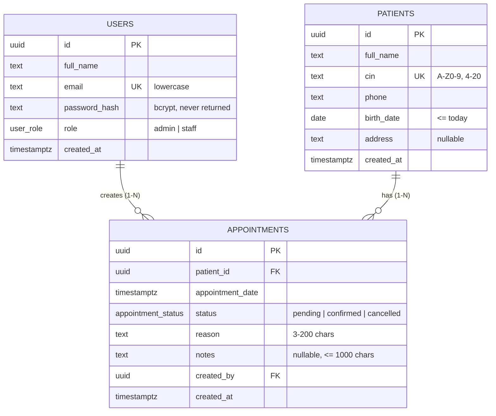

# ClinicFlow — Database design

Schema source: [`backend/migrations/001_init.sql`](../backend/migrations/001_init.sql).

## ERD



## Relations

| Relation | Type | Why |
|---|---|---|
| `patients` → `appointments` | **1-N** | A patient has many appointments over time; an appointment belongs to exactly one patient (`patient_id NOT NULL`). |
| `users` → `appointments` (`created_by`) | **1-N** | Traceability: who booked the appointment. A staff member books many appointments. |

**No N-N.** Nothing in the current scope links many of one entity to many of another. If the clinic later adds
doctors or services, the extensions would be:

- `doctors` table with `appointments.doctor_id` → another **1-N** (one doctor, many appointments).
- `appointment_services (appointment_id, service_id)` join table → **N-N** (one visit, several services; one service, many visits).

**No 1-1.** `users` (clinic staff who log in) and `patients` (people being treated) are deliberately separate tables:
staff are not patients and patients do not log in. A 1-1 would only appear if user profile data were split
out of `users` (e.g. a `user_profiles` table keyed by `user_id`).

## Primary keys

UUIDs (`gen_random_uuid()`) everywhere: ids are not guessable or enumerable from URLs (`/patients/:id`),
and they can be generated without a round-trip if needed.

## Cascade rules

| Foreign key | Rule | Why |
|---|---|---|
| `appointments.patient_id → patients.id` | `ON DELETE CASCADE` | Deleting a patient (admin only) removes their appointments; an appointment without a patient is meaningless. The UI warns about this in the confirm dialog. |
| `appointments.created_by → users.id` | `ON DELETE RESTRICT` | A user who has booked appointments cannot be deleted; this keeps the audit trail intact. (Deactivating a user would be the way to go.) |

## Constraints

| Constraint | Purpose |
|---|---|
| `ENUM user_role ('admin','staff')` | Role is one of a closed set; enforced by the DB, not only by the API. |
| `ENUM appointment_status ('pending','confirmed','cancelled')` | Same for status. |
| `patients.cin UNIQUE` + `CHECK (cin ~ '^[A-Z0-9]{4,20}$')` | One patient per national id; stored normalised in upper case so `ab123` and `AB123` cannot both exist. |
| `patients.birth_date CHECK (>= 1900-01-01 AND <= CURRENT_DATE)` | No future or absurd birth dates. |
| `users.email UNIQUE` + `CHECK (email = lower(email))` | Login is case-insensitive without needing `citext`. |
| Length `CHECK`s on names, reason and notes | Mirrors the Zod rules so bad data cannot enter through another path. |

## Indexes

| Index | Serves |
|---|---|
| `idx_patients_full_name_trgm` — GIN `gin_trgm_ops` on `full_name` | `full_name ILIKE '%term%'` search (a B-tree cannot serve a leading wildcard). |
| `idx_patients_cin_trgm` — GIN `gin_trgm_ops` on `cin` | Partial CIN search (`cin ILIKE '%123%'`). |
| `patients_cin_key` (from `UNIQUE`) | Exact CIN lookups and the uniqueness check. |
| `idx_appointments_patient_date (patient_id, appointment_date)` | The patient details list (`WHERE patient_id = $1 ORDER BY appointment_date`) **and** the 30-minute conflict check (`patient_id = $1 AND appointment_date BETWEEN …`). |
| `idx_appointments_date (appointment_date)` | Day filter and the dashboard "today" count. Both are written as a range (`>= day start AND < next day start`), so the index is used. |
| `idx_appointments_status (status)` | Status filter and the pending/confirmed counts. |
| `idx_appointments_created_by (created_by)` | Postgres does not index FKs automatically; this keeps the `ON DELETE RESTRICT` check on `users` fast. |

## Time zones

`appointment_date` is a `TIMESTAMPTZ` (an absolute instant). "Today" and the `?date=` filter are calendar days in
`APP_TIMEZONE` (`Africa/Casablanca`), converted to a UTC range in SQL:

```sql
appointment_date >= ($date::timestamp AT TIME ZONE 'Africa/Casablanca')
AND appointment_date < (($date + 1)::timestamp AT TIME ZONE 'Africa/Casablanca')
```

The frontend always shows and takes input in the clinic time zone, so a browser in another zone still books 09:00 clinic time.

## Business rule: no two confirmed appointments within 30 minutes

For the same patient, two `confirmed` appointments must be at least 30 minutes apart (10:00 and 10:29 conflict,
10:00 and 10:30 are fine). Pending and cancelled appointments never block.

Checked in `appointments.service.ts` on `POST /appointments` (when `status = confirmed`) and on
`PATCH /appointments/:id/status` (when moving to `confirmed`), inside one transaction:

1. `SELECT … FROM patients WHERE id = $1 FOR UPDATE` locks the patient row. Two concurrent bookings for the
   same patient now run one after the other, so both cannot pass the check before either inserts (no race).
   Other patients are not blocked.
2. Look for a confirmed appointment with `appointment_date` strictly within ±30 minutes (excluding the one being updated).
3. Found → `409 APPOINTMENT_CONFLICT`, "Patient already has a confirmed appointment within 30 minutes".

An `EXCLUDE USING gist` constraint on `tstzrange` was considered. It would enforce the rule in the database itself, but
it needs `btree_gist` and a range column, and it would return a less readable error. The row lock is simpler
to explain and to test.
